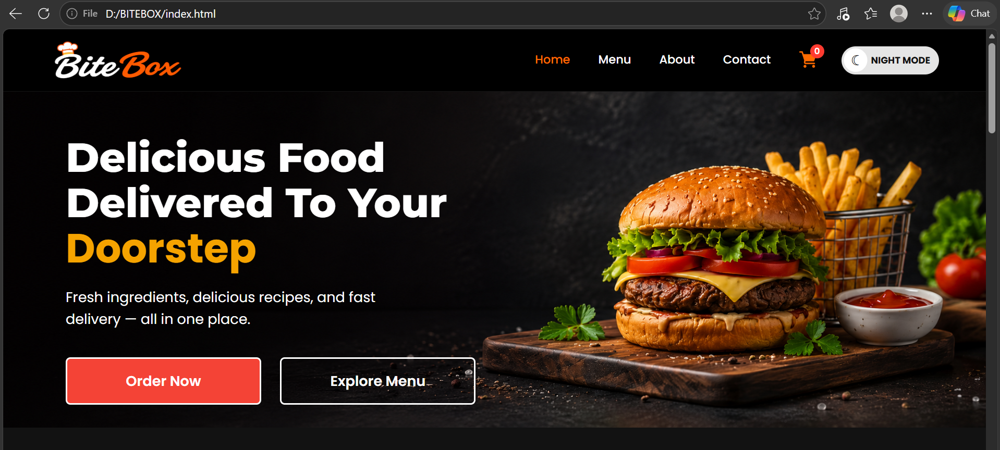
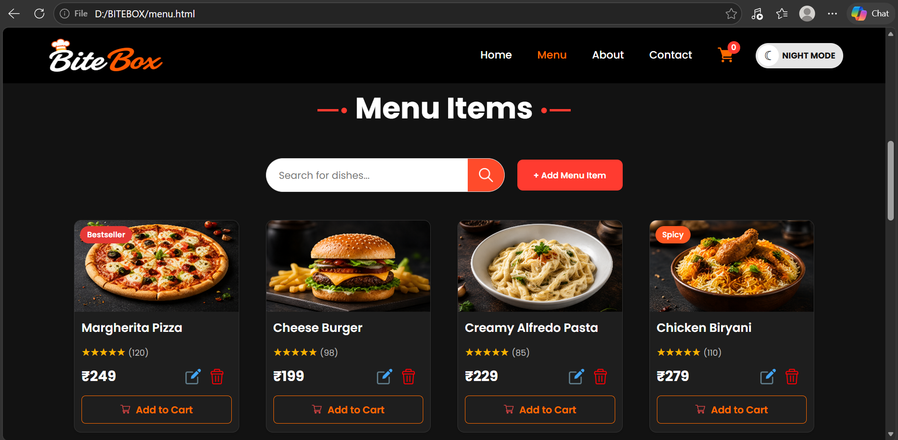
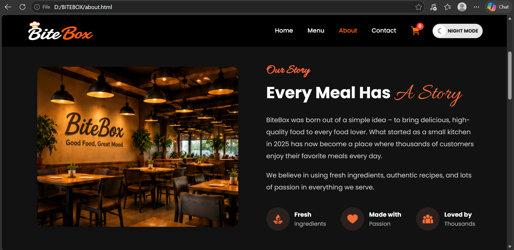
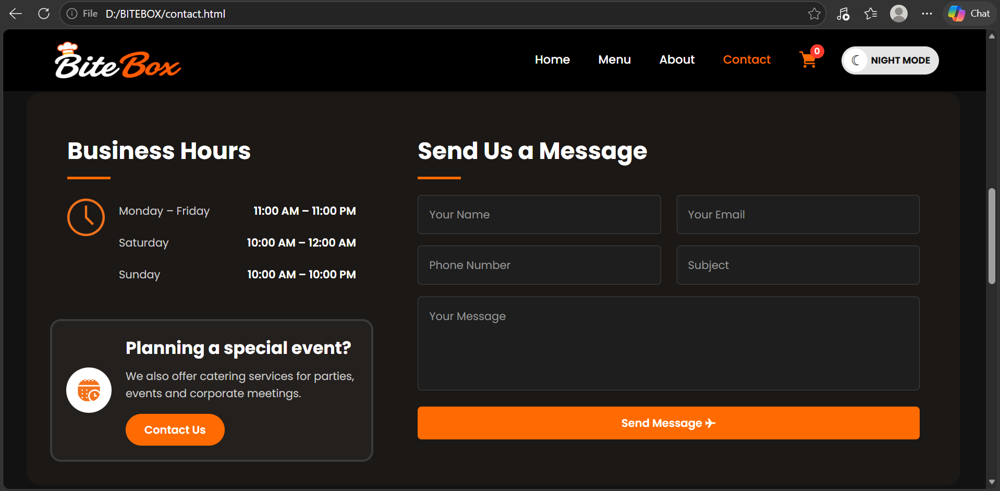
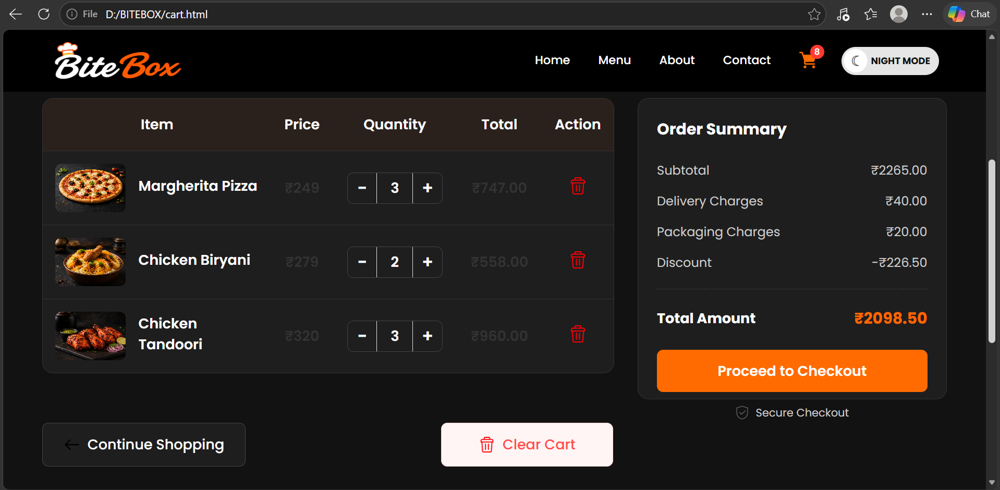
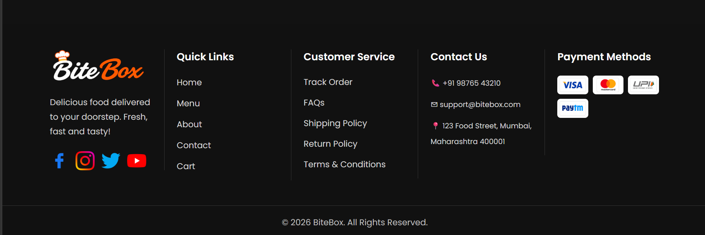

# 🍔 BiteBox – Restaurant Website

> A complete multi-page restaurant website built with HTML, CSS, and JavaScript — featuring responsive design, interactive cart, menu search, dark/light theme, and modern UI.

---

### 📌 Project Overview
**BiteBox** is a full front-end food ordering style website.  
It includes Home, Menu, About, Contact, and Cart pages with a working shopping cart system using `localStorage`, menu search/filter, order calculations, and a day/night mode toggle.

---

### ✨ Features

- Multi-page layout (Home, Menu, About, Contact, Cart)
- Fully responsive design (desktop + mobile)
- Sticky header with active navigation
- Dark / Light theme toggle
- Menu search
- Category filtering
- Add to Cart with **localStorage**
- Quantity controls (+ / −)
- Dynamic Order Summary  
  - Subtotal  
  - Delivery charges  
  - Packaging charges  
  - Discount  
  - Total amount  
- Contact form + business hours section
- Professional footer with social links and payment icons
- Clean card-based UI with hover effects

---

### 📸 Screenshots

#### Home

#### Menu

#### About

#### Contact

#### Cart

#### Footer

---

### 🛠️ Tech Stack

| Layer        | Technology |
|--------------|------------|
| Structure    | HTML5 |
| Styling      | CSS3 (Flexbox, Grid, Media Queries) |
| Interactivity| JavaScript (DOM, Events, localStorage) |
| Fonts        | Google Fonts |

---

### 📂 Project Structure
BiteBox-Restaurant-Website/
│
├── index.html
├── menu.html
├── about.html
├── contact.html
├── cart.html
├── css/
│   └── style.css
├── js/
│   └── script.js
├── assets/
│   ├── images/
│   ├── icons/
│   └── screenshots/
└── README.md

---

### 🚀 How to Run
1. Download / clone the repository
2. Open `index.html` in any browser
3. Use Menu → Add to Cart → Cart to test interactivity
4. Toggle **Night Mode / Day Mode** from the header

**Live Demo:**  
`https://abhishekjambhale18-creator.github.io/BiteBox-Restaurant-Website/`  
*(Enable GitHub Pages after uploading)*

---

### 🧠 What I Learned
- Building multi-page static websites
- Responsive layout with media queries
- DOM manipulation with JavaScript
- Using `localStorage` for cart data
- UI design for real-world style restaurant websites

---

### 👨‍💻 Author
**Abhishek Jambhale**  
MCA Student | Aspiring Data Analyst & Data Scientist  
📍 Pune, Maharashtra  

- LinkedIn: [abhishek-jambhale](https://www.linkedin.com/in/abhishek-jambhale-4a3002442)  
- Email: abhishekjambhale.18@gmail.com  

---

⭐ Star this repository if you like the project!
